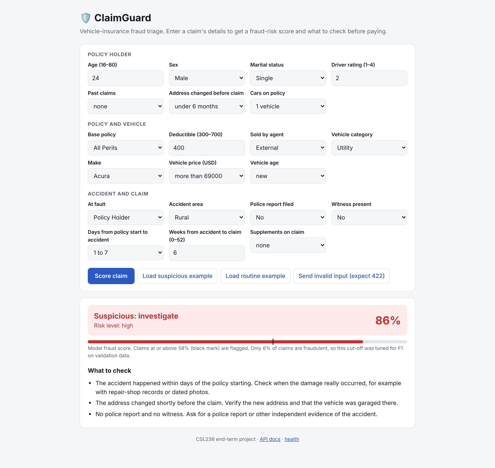
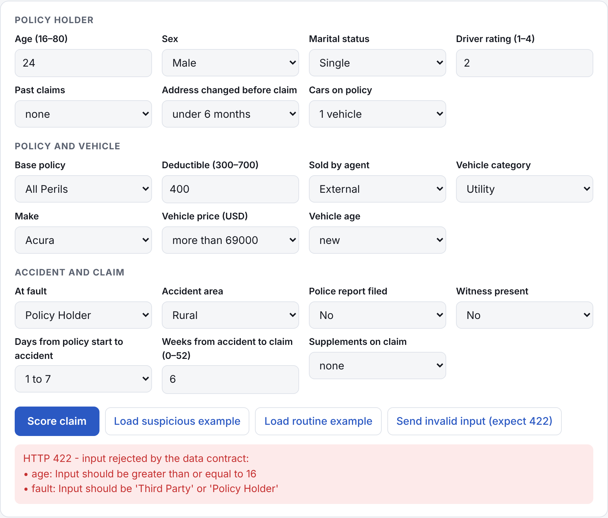
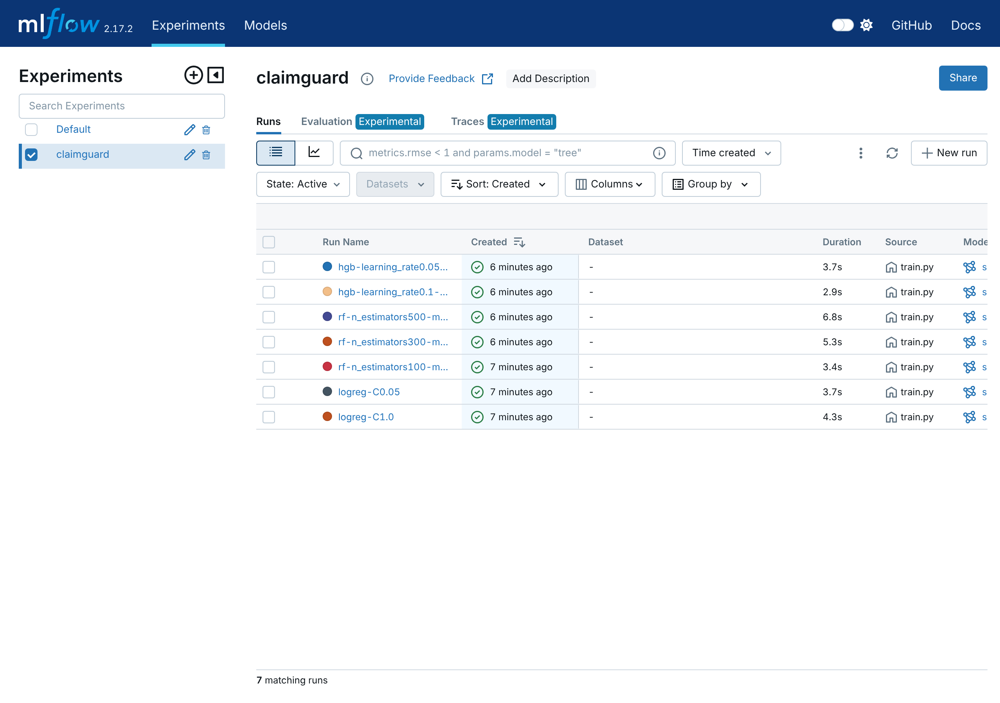
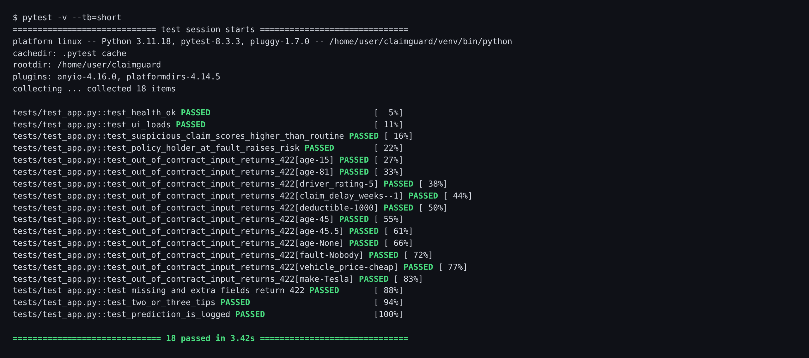

# ClaimGuard: Vehicle Insurance Claim Fraud Detection

CSL236 Introduction to AI & ML, end-term project (B.Tech CSE, Semester 5, The NorthCap University).

ClaimGuard scores a vehicle-insurance claim for fraud risk and tells the claims investigator what to check before paying. It is built as a production-style ML system: MLflow-tracked experiments, a validated FastAPI service with a UI, automated tests, a lean Docker image, GitHub Actions CI and a live deployment.

| | |
|---|---|
| **Live app** | `<add live URL after deployment>` |
| **API docs** | `<live URL>/docs` |
| **Report** | `<link to Name_RollNo.pdf>` |

---

## 1. Problem statement

Insurance fraud (staged accidents, claims for damage that happened before the policy, inflated repairs) costs insurers billions, and checking every claim by hand is slow. Given the details of a claim (policy, vehicle, driver and accident), the model predicts whether it is **fraudulent (1)** or **genuine (0)**. The app is a **triage tool**: it ranks claims by risk, so investigators look at the most suspicious ones first. A human always makes the final decision.

**Type:** binary classification. **Rows:** 15,419 claims after cleaning. **Input features:** 21. **Positive class:** 6.0% (923 frauds).

## 2. Dataset

* **Source:** *Vehicle Insurance Claim Fraud Detection* (`fraud_oracle.csv`), Oracle sample data published on Kaggle by Shivam Bansal: https://www.kaggle.com/datasets/shivamb/vehicle-claim-fraud-detection. The copy in `data/` was taken from a public GitHub mirror (https://github.com/abhisheks008/Car.ly), because Kaggle requires a login. Rebuild it with `python data/download_data.py`.
* **Size:** 15,420 rows × 33 original columns (3.6 MB, committed in `data/`).
* **Cleaning** (`features.load_clean`): drop 3 columns that are not part of the original dataset; set `Age = 0` (320 rows) to missing; drop 1 row with no claim date; fix misspelt car makes and group very rare makes into "Other"; engineer `claim_delay_weeks` from the accident and claim month/week; drop ID-like, redundant and near-constant columns. The notebook (`notebooks/claimguard_eda_and_modelling.ipynb`) explains each decision.

### Data contract

Every rule below is enforced by the Pydantic schema in `app.py`. A value outside the range or set, a wrong type (e.g. `"45"` or `45.5` for an int), `null`/NaN, a missing field or an unknown extra field returns **HTTP 422**.

| Feature | Type | Allowed range / values | Why it matters |
|---|---|---|---|
| `age` | int | 16 – 80 | Age of the policy holder; younger drivers show slightly higher fraud rates |
| `deductible` | int | 300 – 700 | Amount the holder pays first; unusual deductibles correlate with fraud |
| `driver_rating` | int | 1 – 4 | Insurer's risk rating of the driver |
| `claim_delay_weeks` | int | 0 – 52 | Weeks between accident and claim; late reporting is a classic red flag |
| `sex` | binary (str) | `Female`, `Male` | Demographic attribute in the source data |
| `fault` | binary (str) | `Third Party`, `Policy Holder` | Fraud is about 8× more common when the holder is at fault |
| `accident_area` | binary (str) | `Rural`, `Urban` | Rural accidents have fewer witnesses and a higher fraud rate |
| `police_report_filed` | binary (str) | `No`, `Yes` | Independent evidence of the accident |
| `witness_present` | binary (str) | `No`, `Yes` | Independent evidence of the accident |
| `agent_type` | binary (str) | `External`, `Internal` | Policies sold by internal agents show less fraud |
| `vehicle_price` | ordinal (str) | `less than 20000` < `20000 to 29000` < `30000 to 39000` < `40000 to 59000` < `60000 to 69000` < `more than 69000` | Expensive cars mean larger payouts |
| `age_of_vehicle` | ordinal (str) | `new` < `2 years` < … < `7 years` < `more than 7` | Value and condition of the car |
| `past_number_of_claims` | ordinal (str) | `none` < `1` < `2 to 4` < `more than 4` | The holder's claim history |
| `number_of_supplements` | ordinal (str) | `none` < `1 to 2` < `3 to 5` < `more than 5` | Add-on claims to the original |
| `address_change_claim` | ordinal (str) | `no change` < `under 6 months` < `1 year` < `2 to 3 years` < `4 to 8 years` | A recent address change is a known fraud pattern |
| `number_of_cars` | ordinal (str) | `1 vehicle` < `2 vehicles` < `3 to 4` < `5 to 8` < `more than 8` | Size of the policy |
| `days_policy_accident` | ordinal (str) | `none` < `1 to 7` < `8 to 15` < `15 to 30` < `more than 30` | Accidents right after the policy starts are suspicious |
| `marital_status` | nominal (str) | `Single`, `Married`, `Divorced`, `Widow` | Demographic attribute |
| `base_policy` | nominal (str) | `Liability`, `Collision`, `All Perils` | Liability-only policies don't pay for the holder's own car, so fraud is near zero |
| `vehicle_category` | nominal (str) | `Sedan`, `Sport`, `Utility` | Vehicle type |
| `make` | nominal (str) | `Pontiac`, `Toyota`, `Honda`, `Mazda`, `Chevrolet`, `Acura`, `Ford`, `VW`, `Dodge`, `Saab`, `Mercury`, `Saturn`, `Other` | Manufacturer (rare makes grouped as `Other`) |
| **`fraud`** (target) | binary | `{0, 1}` | Label: 1 = fraudulent claim |

## 3. Repository structure

```
claimguard/
├── data/
│   ├── fraud_oracle.csv          # raw dataset (3.6 MB)
│   └── download_data.py          # re-download script
├── model/
│   ├── model.joblib              # best model (sklearn Pipeline: preprocessing + classifier)
│   └── model_meta.json           # run id, params, tuned threshold, test metrics
├── notebooks/
│   └── claimguard_eda_and_modelling.ipynb   # EDA, preprocessing decisions, model comparison
├── static/index.html             # UI
├── tests/test_app.py             # pytest suite (18 tests)
├── .github/workflows/ci.yml      # GitHub Actions
├── app.py                        # FastAPI app + Pydantic schema
├── features.py                   # shared cleaning, data contract and preprocessing
├── train.py                      # training script with MLflow tracking
├── drift_check.py                # bonus: drift check on logged inputs
├── Dockerfile                    # python:3.11-slim serving image
├── requirements.txt              # full dev/training environment
├── requirements-serve.txt        # lean serving runtime (no MLflow/pytest)
├── mlflow.db                     # MLflow experiment history (SQLite)
└── docs/                         # figures, screenshots, sample prediction log
```

## 4. Setup and run

### Local

```bash
python3 -m venv venv && source venv/bin/activate        # Windows: venv\Scripts\activate
pip install -r requirements.txt
python train.py --n_estimators 100 --max_depth 6        # one run; see section 5 for all runs
mlflow ui --backend-store-uri sqlite:///mlflow.db       # http://127.0.0.1:5000
uvicorn app:app --reload --port 8000                    # UI at http://127.0.0.1:8000, docs at /docs
pytest -v --tb=short
```

### Docker

```bash
docker build -t claimguard .
docker run -d -p 8000:8000 --restart unless-stopped claimguard
curl http://localhost:8000/health
```

Image size: **≈ 695 MB on disk (≈ 140 MB compressed)**. Most of it is scikit-learn, SciPy, NumPy and pandas. The image is built from `python:3.11-slim` with `requirements-serve.txt` only, so MLflow, pytest, matplotlib and Jupyter are not included.

### API

| Method | Path | Purpose |
|---|---|---|
| GET | `/` | UI |
| GET | `/health` | Liveness check plus model info |
| POST | `/predict` | Score one claim. Returns `label`, `fraud_probability`, `threshold`, `risk_level` and 2–3 `tips` |
| GET | `/docs` | Swagger UI |

```bash
curl -X POST localhost:8000/predict -H "Content-Type: application/json" -d '{
  "age": 24, "deductible": 400, "driver_rating": 2, "claim_delay_weeks": 6, "sex": "Male",
  "fault": "Policy Holder", "accident_area": "Rural", "police_report_filed": "No", "witness_present": "No",
  "agent_type": "External", "vehicle_price": "more than 69000", "age_of_vehicle": "new",
  "past_number_of_claims": "none", "number_of_supplements": "none", "address_change_claim": "under 6 months",
  "number_of_cars": "1 vehicle", "days_policy_accident": "1 to 7", "marital_status": "Single",
  "base_policy": "All Perils", "vehicle_category": "Utility", "make": "Acura"}'
```

## 5. Experiments (MLflow)

`train.py` takes hyperparameters as CLI arguments and logs params, metrics and the fitted pipeline to MLflow (SQLite backend). Because only 6% of claims are fraud, each run tunes its decision threshold for maximum F1 on a validation slice of the **training** data, then reports metrics on the untouched 20% test set. Runs:

```bash
python train.py --model logreg --C 1.0
python train.py --model logreg --C 0.05
python train.py --model rf --n_estimators 100 --max_depth 6
python train.py --model rf --n_estimators 300 --max_depth 12 --min_samples_leaf 3
python train.py --model rf --n_estimators 500 --min_samples_leaf 5
python train.py --model hgb --learning_rate 0.1 --max_iter 200 --max_depth 4
python train.py --model hgb --learning_rate 0.05 --max_iter 400 --max_depth 6
```

| Run | Algorithm | Hyperparameters | ROC-AUC | PR-AUC | Recall | Precision | F1 | Threshold |
|---|---|---|---|---|---|---|---|---|
| 1 | Logistic Regression | C=1.0 | 0.804 | 0.151 | 0.486 | 0.163 | 0.244 | 0.69 |
| 2 | Logistic Regression | C=0.05 | 0.804 | 0.150 | 0.530 | 0.157 | 0.242 | 0.66 |
| 3 | Random Forest | n_estimators=100, max_depth=6 | 0.823 | 0.205 | 0.751 | 0.154 | 0.255 | 0.58 |
| 4 | Random Forest | n_estimators=300, max_depth=12, min_samples_leaf=3 | 0.820 | 0.197 | 0.562 | 0.160 | 0.249 | 0.55 |
| 5 | Random Forest | n_estimators=500, min_samples_leaf=5 | 0.818 | 0.201 | 0.611 | 0.156 | 0.248 | 0.42 |
| 6 | HistGradientBoosting | lr=0.1, max_iter=200, max_depth=4 | 0.833 | 0.241 | 0.335 | 0.218 | 0.264 | 0.72 |
| **7** | **HistGradientBoosting** | **lr=0.05, max_iter=400, max_depth=6** | **0.833** | **0.246** | **0.832** | **0.145** | **0.247** | **0.58** |

### Which model we chose and why

**Run 7, HistGradientBoosting (learning rate 0.05, depth 6).**

1. **Best PR-AUC (0.246, about 4× the 0.06 of random guessing).** With 6% positives, PR-AUC shows how well the model ranks rare fraud cases, which matters more than accuracy. A model that always says "genuine" would be 94% accurate and useless.
2. **Highest recall: it catches 83% of frauds** at its tuned threshold. In triage, a missed fraud costs far more than one extra claim checked by an investigator.
3. **It handles interactions.** Fraud mostly happens when the holder is at fault *and* the policy covers their own car. Boosted trees learn such combinations natively, while logistic regression can't.
4. **Small and fast:** about 1 MB on disk, with millisecond predictions.

Run 6 has a slightly higher F1, but it catches only a third of the frauds, so it fails the triage goal. `train.py` keeps the model with the best test PR-AUC, and that is run 7.

## 6. Tests (`pytest -v`)

18 tests in `tests/test_app.py`:

* **Health check:** `/health` returns 200 and `model_loaded: true`.
* **UI loads:** `/` returns the HTML page.
* **Domain logic:** a claim with classic red flags (accident in the first week of an all-perils policy, recent address change, holder at fault, no police report or witness, late report) must score higher than a routine third-party, liability-only claim. Changing **only** `fault` from Third Party to Policy Holder must raise the risk.
* **Boundary / 422:** 11 parameterised cases (age 15 and 81, rating 5, negative delay, deductible 1000, `"45"` as a string, `45.5`, `null`, unknown category, unknown ordinal level, unknown make), plus missing-field and extra-field cases.
* **Tips:** every response has 2–3 tips.
* **Logging:** each prediction is appended to the log file.

## 7. CI/CD

`.github/workflows/ci.yml` runs on every push and pull request to `main`:

1. **train-and-test:** set up Python 3.11, `pip install -r requirements.txt`, train a baseline model (`python train.py --n_estimators 100 --max_depth 6 --force`, into a throwaway MLflow DB), then `pytest -v`.
2. **docker-build:** build the image, start the container, check `/health` and `/`, confirm invalid input returns 422, and print the image size.

## 8. Deployment and monitoring

* Deployed as a Docker container on `<Render / Railway / EC2>` with a restart policy (`--restart unless-stopped` on a VM; the platform's auto-restart on Render/Railway). The container reads `$PORT` when the platform sets one.
* **Prediction logging:** every `/predict` input, its probability and label are appended as one JSON line to `logs/predictions.jsonl` (rotating file). A sample log is in `docs/sample_predictions.jsonl`.
* **Bonus: drift check.** `python drift_check.py` compares logged inputs with the training data: the mean/std of numeric features (flagged above 0.5 training standard deviations) and category shares (flagged above 15 percentage points). It exits with code 1 on drift, so a scheduled job could trigger retraining.

## 9. Screenshots

| | |
|---|---|
| UI with a prediction |  |
| Invalid input rejected (422) |  |
| MLflow runs |  |
| pytest |  |
| `/docs` | `<add after deployment: docs/screenshots/docs.png>` |
| Green CI check | `<add after first push: docs/screenshots/ci_green.png>` |

## 10. Limitations

* The data is old (1994–1996) US sample data. Fraud patterns and prices today are different.
* Only 923 fraud examples, and many inputs arrive already bucketed into ranges, which caps how precise the model can be (precision is about 15%). It is a triage aid, not an automatic decision maker.
* `sex` and `marital_status` are protected attributes. A real deployment would need a fairness review, or would drop them.

## 11. Team

| Name | Roll number | Contribution |
|---|---|---|
| Krishna Bakshi | 24CSU297 | Data cleaning and EDA notebook, data contract, train.py and MLflow experiments, model selection, report |
| Naman Sharma | 24CSU287 | FastAPI app and Pydantic validation, UI, pytest suite, Dockerfile, GitHub Actions CI, deployment and drift check, slides |
